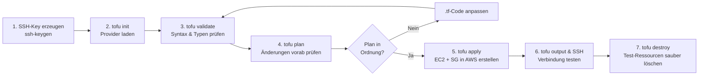
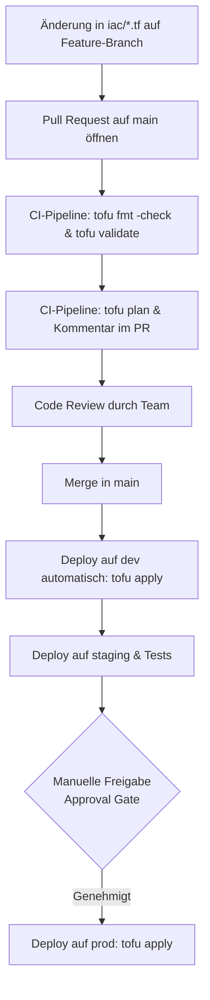

# Infrastructure as Code (IaC) Dokumentation – TicTacTest

Diese Dokumentation beschreibt die Umsetzung und theoretischen Grundlagen des Auftrags **«OpenTofu / Terraform – Erste Cloud-Infrastruktur»** im Modul 324 im Repository des Projekts **TicTacTest**.

---

## 1. Zugang zum AWS Learner Lab

Für das Modul **324 HS26 IAC** wird das **AWS Academy Learner Lab** verwendet (Kurs-URL: https://awsacademy.instructure.com/courses/177097).

### Ablauf für den Zugriff & die Authentifizierung
1. Anmeldung in AWS Academy und Öffnen des Kurses unter [https://awsacademy.instructure.com/courses/177097](https://awsacademy.instructure.com/courses/177097).
2. Starten des **Learner Lab** über *Modules* → *Learner Lab* → Button **Start Lab** (warten, bis der Status-Indikator grün wird).
3. Abrufen der temporären Zugangsdaten über **AWS Details** → **AWS CLI: Show** (`aws_access_key_id`, `aws_secret_access_key`, `aws_session_token`).
4. Hinterlegen der Zugangsdaten lokal in `~/.aws/credentials` oder über Umgebungsvariablen (`AWS_ACCESS_KEY_ID`, `AWS_SECRET_ACCESS_KEY`, `AWS_SESSION_TOKEN`).

> [!NOTE]
> **Verfügbarkeit & Verifizierung:** Der persönliche Login ins AWS Academy Portal, der Start des Learner Labs sowie der tatsächliche `tofu apply`-Lauf inklusive SSH-Test werden direkt in der eigenen AWS-Academy-Sitzung durchgeführt (temporäre Session-Credentials laufen nach ca. 4 Stunden ab und dürfen niemals ins Repository gelangen).

### Verfügbare AWS-Services und Einschränkungen im Learner Lab
Im AWS Learner Lab stehen typischerweise folgende Kern-Services zur Verfügung (standardmäßig in der Region `us-east-1`):
- **Compute:** Amazon EC2 (kleine Instanztypen wie `t2.micro`, `t3.micro`, Security Groups, Key Pairs), AWS Lambda, ECS/ECR.
- **Storage & Datenbanken:** Amazon S3, Amazon EBS, Amazon RDS (kleine Instanzen), DynamoDB.
- **Networking:** Amazon VPC, Subnets, Route Tables, Internet Gateways.
- **IAM & Monitoring:** Vordefinierte Rollen (`LabRole` – das Erstellen eigener IAM-Rollen oder -User ist aus Sicherheitsgründen eingeschränkt), Amazon CloudWatch.

---

## 2. Einführung und Grundlagen (Begriffe in eigenen Worten)

| Begriff | Erklärung in eigenen Worten |
| :--- | :--- |
| **Infrastructure as Code (IaC)** | Anstatt Server, Netzwerke und Firewall-Regeln manuell in einer Web-Oberfläche zusammenzuklicken, wird die gesamte Infrastruktur in maschinenlesbaren Konfigurationsdateien als Code beschrieben. Dadurch lässt sie sich in Git versionieren, überprüfen, teilen und jederzeit exakt reproduzierbar aufbauen. |
| **Deklarativ vs. Imperativ** | **Deklarativ** (wie bei OpenTofu/Terraform) bedeutet: Man beschreibt den gewünschten **Zielzustand** (z. B. *«Es soll eine `t2.micro`-EC2-Instanz existieren»*) – das Tool berechnet selbstständig den Weg dorthin. **Imperativ** (z. B. ein Bash-Script mit `aws ec2 run-instances`) beschreibt dagegen jeden einzelnen Ausführungsschritt in exakter Reihenfolge. |
| **Terraform** | Ein weit verbreitetes IaC-Tool von HashiCorp, das Cloud- und On-Premise-Infrastruktur in der Sprache HCL (*HashiCorp Configuration Language*, `.tf`-Dateien) deklarativ definiert und verwaltet. |
| **OpenTofu** | Ein vollständig quelloffener Open-Source-Fork von Terraform unter dem Dach der **Linux Foundation** (Lizenz: MPL 2.0). OpenTofu entstand als offene Alternative nach dem Lizenzwechsel von HashiCorp Terraform zur Business Source License (BSL) und ist mit bestehenden `.tf`-Konfigurationen sowie Terraform-Workflows kompatibel. |
| **Provider** | Ein Plugin bzw. Bindeglied zwischen OpenTofu/Terraform und einer konkreten Plattform-API (z. B. `hashicorp/aws` für AWS, Azure, Cloudflare oder Docker). Der Provider übersetzt die `.tf`-Deklaration in echte API-Aufrufe. |
| **Resource** | Ein einzelnes konkretes Infrastruktur-Objekt, das OpenTofu erstellt, verwaltet oder löscht – z. B. eine EC2-Instanz (`aws_instance`), eine Security Group (`aws_security_group`), ein SSH-Key-Pair (`aws_key_pair`) oder ein S3-Bucket. |
| **Variable** | Ein Eingabeparameter (definiert in `variables.tf`), mit dem Konfigurationen flexibel, anpassbar und für verschiedene Umgebungen (`dev`, `staging`, `prod`) wiederverwendbar gemacht werden, ohne den Hauptcode zu ändern. |
| **Output** | Ein Rückgabewert (definiert in `outputs.tf`), den OpenTofu nach dem `apply` anzeigt – beispielsweise die dynamisch zugewiesene öffentliche IP-Adresse, der DNS-Name oder ein vorbereiteter SSH-Befehl. |
| **State** | Eine Zustandsdatei (`terraform.tfstate`), in der OpenTofu speichert, welche realen Cloud-Ressourcen aktuell existieren und welcher Definition im Code sie entsprechen. |

---

## 3. Erste OpenTofu-Konfiguration im TicTacTest-Repository

Die Infrastruktur-Konfiguration liegt im Verzeichnis [`iac/`](file:///c:/Users/TAASIBH2/repos/450-tictactest-mvk/iac):

```text
iac/
├── providers.tf               # Versionsvorgaben & AWS-Provider inkl. Default-Tags
├── variables.tf               # Konfigurierbare Parameter (Region, Umgebung, Instanztyp, SSH-Key)
├── main.tf                    # AMI-Data-Source, Key Pair, Security Group, EC2-Instanz (t2.micro)
├── outputs.tf                 # Öffentliche IP, DNS-Name, Instanz-ID & SSH-Befehl
├── terraform.tfvars.example   # Vorlage für eigene Variablenwerte (ohne Secrets)
└── .terraform.lock.hcl        # Provider-Lockfile für reproduzierbare Builds
```

### Rolle von Provider und Ressourcen in der Konfiguration
- **Provider (`hashicorp/aws` in [`iac/providers.tf`](file:///c:/Users/TAASIBH2/repos/450-tictactest-mvk/iac/providers.tf)):** Stellt die Verbindung zur AWS-API in der konfigurierten Region (Standard: `us-east-1`) her und versieht alle verwalteten Ressourcen automatisch mit einheitlichen `default_tags` (`Project`, `Environment`, `ManagedBy`).
- **Data Source `aws_ami.amazon_linux` ([`iac/main.tf`](file:///c:/Users/TAASIBH2/repos/450-tictactest-mvk/iac/main.tf)):** Sucht automatisch das aktuellste offizielle Amazon Linux 2023 AMI (`x86_64`, `hvm`, `ebs`), falls keine eigene `ami_id` angegeben wird.
- **Ressource `aws_key_pair.deployer`:** Hinterlegt unseren lokal erzeugten öffentlichen SSH-Schlüssel in AWS, damit wir uns sicher per SSH ohne Passwort einloggen können.
- **Ressource `aws_security_group.tictactest_sg`:** Agiert als virtuelle Firewall vor der EC2-Instanz. Sie gibt eingehend explizit nur **TCP Port 22 (SSH)** (konfigurierbar über `var.allowed_ssh_cidr`) frei und erlaubt ausgehenden Traffic für Paketupdates und Container-Pulls.
- **Ressource `aws_instance.tictactest_server`:** Startet eine kostengünstige **`t2.micro`**-EC2-Instanz, verknüpft sie mit Key Pair und Security Group und installiert beim ersten Booten über `user_data` automatisch **Docker**.

### Typischer OpenTofu-Ablauf (`init` → `plan` → `apply` → `destroy`)



#### Praktische Ausführungsschritte

1. **Lokales SSH-Schlüsselpaar generieren (wird NICHT ins Git-Repo abgelegt):**
   ```bash
   ssh-keygen -t ed25519 -f ~/.ssh/tictactest_key -C "tictactest-aws"
   ```
2. **Lokale `terraform.tfvars` in `iac/` anlegen (durch `.gitignore` vor Git-Commits geschützt):**
   ```bash
   cp iac/terraform.tfvars.example iac/terraform.tfvars
   # In iac/terraform.tfvars den Inhalt von ~/.ssh/tictactest_key.pub bei ssh_public_key eintragen
   ```
3. **Projekt initialisieren und validieren:**
   ```bash
   cd iac
   tofu init
   tofu validate
   ```
   - `tofu init`: Lädt das `hashicorp/aws`-Provider-Plugin herunter und initialisiert `.terraform/`.
   - `tofu validate`: Prüft Syntax, Variablenreferenzen und Provider-Schema lokal ohne Cloud-Änderung.
4. **Änderungsplan erstellen und prüfen:**
   ```bash
   tofu plan
   ```
   OpenTofu vergleicht die `.tf`-Dateien mit dem aktuellen `State` sowie der realen AWS-Umgebung und listet exakt auf, welche Ressourcen neu angelegt (`+ create`), geändert (`~ update`) oder zerstört (`- destroy`) würden.
5. **Infrastruktur erstellen:**
   ```bash
   tofu apply
   ```
   Nach Bestätigung mit `yes` legt AWS das Key Pair, die Security Group und die `t2.micro`-EC2-Instanz an.
6. **Outputs auslesen und SSH-Verbindung überprüfen:**
   ```bash
   tofu output
   ssh -i ~/.ssh/tictactest_key ec2-user@$(tofu output -raw public_ip)
   ```
   Nach erfolgreicher Anmeldung auf der EC2-Instanz kann zudem überprüft werden, ob Docker durch `user_data` eingerichtet wurde (`docker --version`).
7. **Ressourcen nach dem Test wieder zerstören:**
   ```bash
   tofu destroy
   ```

### Vorbereitung für das spätere Deployment von TicTacTest als Online-Container
Dieses Setup legt das Fundament für den Übergang von einer lokalen Java-Konsolenanwendung zu einem in der Cloud betriebenen Container-Dienst:
1. **Laufzeitumgebung per Bootstrapping:** Das `user_data`-Skript installiert und aktiviert **Docker** bereits beim Start der EC2-Instanz. Dadurch ist der Host sofort bereit, ein TicTacTest-Container-Image (z. B. aus der GitHub Container Registry `ghcr.io`) per `docker pull` und `docker run` auszuführen.
2. **Netzwerk-Basis:** Die `aws_security_group` trennt heute SSH sauber ab und kann später einfach um einen Anwendungs-Port (z. B. Port `8080` oder HTTPS `443` vor einem Reverse Proxy) erweitert werden, sobald TicTacTest eine Web-/API-Schnittstelle erhält.
3. **Parametrisierung:** Durch Variablen wie `environment` (`dev`, `staging`, `prod`) und `instance_type` lässt sich genau dieselbe Konfiguration später für echte Deployment-Stages wiederverwenden.

---

## 4. Verständnis von State und Git-Sicherheit

### Was ist der State und warum ist er so wichtig?
Die State-Datei (`terraform.tfstate`) bildet die **Brücke zwischen den `.tf`-Konfigurationsdateien und den real existierenden Cloud-Ressourcen**. Sie speichert unter anderem eindeutige Cloud-IDs (z. B. `i-0abc123...`), IP-Adressen, Abhängigkeiten und Metadaten.

**Warum der State unverzichtbar ist:**
- **Abgleich (`plan`):** Nur über den State weiß OpenTofu, welche Ressourcen es selbst verwaltet und ob Änderungen ein Update, ein Ersetzen oder ein Löschen erfordern.
- **Sauberes Aufräumen (`destroy`):** Ohne State müsste jede Ressource mühsam manuell gesucht und gelöscht werden.
- **Sensible Daten:** Im State stehen viele Details im Klartext – auch Attribute, die Passwörter, Token oder sensible Konfigurationen enthalten können.

> [!CAUTION]
> **Remote-State im Team:** Lokal liegt der State in `terraform.tfstate`. Im Team oder in CI/CD darf der State nicht lokal auf einem Entwickler-Laptop liegen, sondern wird in einem verschlüsselten **Remote-Backend** (z. B. AWS S3 Bucket mit State Locking via DynamoDB oder S3-Lockfile) gespeichert.

### Was darf in Git committed werden und was NIEMALS?

In der Root-[`.gitignore`](file:///c:/Users/TAASIBH2/repos/450-tictactest-mvk/.gitignore) sind die Schutzregeln fest hinterlegt:

| Gehört **IN Git** (Versionierung) | Gehört **NIEMALS IN Git** (Sensibel / Lokal / Generiert) |
| :--- | :--- |
| `iac/*.tf` (`main.tf`, `variables.tf`, `outputs.tf`, `providers.tf`) | `*.tfstate` und `*.tfstate.*` (enthalten Infrastruktur-Interna und ggf. Klartext-Secrets) |
| `iac/.terraform.lock.hcl` (sichert exakt gleiche Provider-Versionen im Team) | `**/.terraform/*` (große, plattformspezifische heruntergeladene Provider-Binaries) |
| `iac/terraform.tfvars.example` (Vorlage mit Platzhaltern) | `*.tfvars` / `*.tfvars.json` (sobald sie echte Secrets, IPs oder Keys enthalten) |
| `.gitignore`, `.github/workflows/iac.yml`, `.devcontainer/Dockerfile`, `IAC.md` | **Private SSH-Keys** (`*.pem`, `*.key`, `*.ppk`, `id_rsa*`, `id_ed25519*`) |
| | **Cloud Credentials** (`AWS_ACCESS_KEY_ID`, `AWS_SECRET_ACCESS_KEY`, `AWS_SESSION_TOKEN`, `~/.aws/credentials`) |

---

## 5. Kostenkontrolle & Verantwortungsvolles Arbeiten in der Cloud

### Kosten einer laufenden `t2.micro`-EC2-Instanz (Richtwerte AWS `us-east-1`)
- **EC2 Compute (`t2.micro`, On-Demand Linux):** ca. `0.0116 USD/Stunde` → bei 24/7-Betrieb (730 Stunden) ca. **`8.47 USD/Monat`**.
- **EBS Root-Volume (z. B. 8–30 GB `gp3`):** ca. `0.08 USD/GB/Monat` → bei 8 GB ca. **`0.64 USD/Monat`**.
- **Öffentliche IPv4-Adresse:** seit 2024 ca. `0.005 USD/Stunde` → bei 24/7-Betrieb ca. **`3.65 USD/Monat`**.
- Im **AWS Free Tier** sind für neue Konten 750 Stunden/Monat `t2.micro`/`t3.micro` (12 Monate) enthalten; im **AWS Learner Lab** wird direkt vom begrenzten Labor-Budget abgerechnet.

### Warum Test-Ressourcen nach dem Test zerstört werden müssen
Wenn Cloud-Ressourcen nach einem Lern- oder Testauftrag weiterlaufen, verbrauchen sie rund um die Uhr Rechenzeit und Labor-Guthaben. Im schlimmsten Fall läuft das Learner-Lab-Budget ab, sodass für spätere Übungen keine Ressourcen mehr gestartet werden können. Ein konsequentes `tofu destroy` am Ende der Übung stellt sicher, dass **keine vergessenen («Zombie»-)Ressourcen** wie verwaiste EC2-Instanzen, Elastic IPs oder EBS-Volumes zurückbleiben.

### Konkrete Maßnahmen zur Kostenkontrolle
1. **Eingabe-Validierung im IaC-Code (`variables.tf`):** Unsere Variable `instance_type` enthält einen `validation`-Block, der nur kleine, günstige Instanztypen (`t2.micro`, `t3.micro`, `t2.small`, `t3.small`) zulässt und teure Versehen (z. B. `m5.4xlarge`) bereits vor dem `plan` verhindert.
2. **Konsequentes Ressourcen-Tagging & Aufräumen:** Alle Ressourcen erhalten über `default_tags` automatisch `Project`, `Environment` und `ManagedBy = "OpenTofu"`. So lassen sich Kosten eindeutig zuordnen und Testumgebungen vollständig per `tofu destroy` abbauen.
3. **AWS Budgets & Billing Alarms (in produktiven Konten):** Einrichtung von Budget-Schwellenwerten (z. B. Warnung bei 50 % und 80 % des Monatsbudgets) per E-Mail-Benachrichtigung sowie automatisches Stoppen von Dev-Instanzen außerhalb der Arbeitszeiten.

### Warum IaC ein zentrales Werkzeug für Kosten- und Ressourcenmanagement ist
Durch IaC existiert eine vollständige Inventarliste im Code und im State: Jede gestartete Ressource ist nachvollziehbar begründet, versioniert und mit einem einzigen Befehl reproduzierbar hoch- oder wieder herunterzufahren. Manuelle «Klick-Experimente» ohne Übersicht über laufende Kosten werden dadurch vermieden.

---

## 6. Ausblick: Infrastruktur in CI/CD und Umgebungen (`dev`, `staging`, `prod`)

### Integration von OpenTofu in eine CI/CD-Pipeline
In einem professionellen DevOps-Prozess werden Infrastruktur-Änderungen genau wie Anwendungs-Code über Pull Requests geprüft und automatisiert ausgerollt:



In diesem Repository prüft bereits der neue GitHub-Actions-Workflow [`.github/workflows/iac.yml`](file:///c:/Users/TAASIBH2/repos/450-tictactest-mvk/.github/workflows/iac.yml) bei jedem Push/PR auf `iac/**` automatisiert Formatierung (`tofu fmt -check`), Initialisierung (`tofu init -backend=false`) und Validität (`tofu validate`).

### Trennung von `dev`, `staging` und `prod`
Später sollen Umgebungen sauber voneinander isoliert werden (z. B. durch getrennte State-Dateien / Workspaces / umgebungsspezifische `.tfvars`-Dateien):
- **`dev` (Entwicklung):** Schnelles Experimentieren mit minimalen Ressourcen (z. B. `t2.micro`), kann abends oder nach Tests zerstört werden.
- **`staging` (Vorproduktion):** Möglichst produktionsnahe Abbildung der Infrastruktur für realistische Integrationstests, E2E-Tests und Load-Tests vor dem Go-Live.
- **`prod` (Produktion):** Streng geschützte Umgebung mit restriktiven Firewall-Regeln (SSH nur über Bastion/VPN oder konkrete IPs), Remote-State-Locking und verpflichtendem manuellem Approval-Gate vor jedem `tofu apply`.

**Warum dieser Ablauf für produktive Anwendungen wichtig ist:**
Nur wenn Infrastrukturänderungen vorab per `plan` sichtbar sind, einem Peer-Review unterliegen und identisch von `dev` über `staging` bis `prod` getestet wurden, lassen sich Ausfälle durch Konfigurationsfehler («Configuration Drift» oder falsche Firewall-Regeln) in der Produktion zuverlässig verhindern.

---

## 7. Reflexionsfragen & Checkliste

### Antworten auf die Reflexionsfragen aus dem Handout
1. **Warum ist Infrastructure as Code besser als manuelle Konfiguration?**
   Weil manuelle Setups fehleranfällig, schlecht dokumentiert und kaum identisch wiederholbar sind (*«Auf meinem Rechner/Testserver funktioniert es»*). IaC macht Infrastruktur versionierbar, überprüfbar (Code-Review), reproduzierbar und automatisierbar.
2. **Was ist der Unterschied zwischen deklarativem und imperativem Vorgehen?**
   Deklarativ beschreibt das **WAS** (den gewünschten Soll-Zustand in `.tf`-Dateien); OpenTofu berechnet die notwendigen API-Schritte selbst. Imperativ beschreibt das **WIE** (einzelne Befehle in fester Reihenfolge), was bei erneuter Ausführung schnell zu Fehlern oder doppelten Ressourcen führt.
3. **Warum ist der State so wichtig?**
   Ohne State kennt OpenTofu die Zuordnung zwischen Code und den tatsächlichen Cloud-Objekten nicht und könnte weder korrekte `plan`-Differenzen berechnen noch Ressourcen zuverlässig aktualisieren oder per `destroy` entfernen.
4. **Welche Risiken entstehen, wenn vertrauliche Informationen im Code landen?**
   Einmal in die Git-Historie committete AWS-Keys, Passwörter oder private SSH-Keys sind für jeden mit Repo-Zugriff (bei öffentlichen Repos weltweit innerhalb von Sekunden) sichtbar. Das führt zu Kontoübernahmen, unerlaubtem Cryptomining mit extremen Cloud-Rechnungen und Sicherheitsvorfällen.
5. **Welche Vorteile bringt der Einsatz einer Cloud-Umgebung für das Lernen?**
   Man arbeitet praxisnah mit realen Netzwerk-, Sicherheits- und Compute-Konzepten (Security Groups, Key Pairs, Public IPs, Linux-Provisioning) und lernt gleichzeitig Kostenbewusstsein durch das bewusste Erstellen und Wiederzerstören von Umgebungen.

### Checkliste (Auftragsblatt & Handout)
- [x] Zugang zum AWS Learner Lab (`324 HS26 IAC`) und verfügbare Services dokumentiert (persönliche Lab-Anmeldung in AWS Academy vorausgesetzt)
- [x] Grundbegriffe (IaC, OpenTofu, Terraform, Provider, Resource, Variable, Output, State) in eigenen Worten erklärt
- [x] Erste OpenTofu-Konfiguration (`providers.tf`, `variables.tf`, `main.tf`, `outputs.tf`, `terraform.tfvars.example`) im Verzeichnis [`iac/`](file:///c:/Users/TAASIBH2/repos/450-tictactest-mvk/iac) angelegt
- [x] `t2.micro` EC2-Instanz, Security Group (SSH Port 22), SSH-Key-Pair-Resource, Variablen & Outputs definiert
- [x] DevContainer ([`.devcontainer/Dockerfile`](file:///c:/Users/TAASIBH2/repos/450-tictactest-mvk/.devcontainer/Dockerfile)) um `opentofu`, `aws-cli` und `openssh-client` erweitert
- [x] `.gitignore` für `.tfstate`, `.terraform/`, `*.tfvars` und private SSH-Keys konfiguriert
- [x] CI-Validierung für OpenTofu ([`.github/workflows/iac.yml`](file:///c:/Users/TAASIBH2/repos/450-tictactest-mvk/.github/workflows/iac.yml)) eingerichtet
- [x] Ablauf `init` → `validate` → `plan` → `apply` → `destroy`, Kostenkontrolle sowie CI/CD-Ausblick dokumentiert
- [ ] *Praktisch in eigener aktiver Learner-Lab-Session auszuführen:* `tofu apply`, SSH-Verbindungstest auf die eigene EC2-Instanz und anschließendes `tofu destroy`
