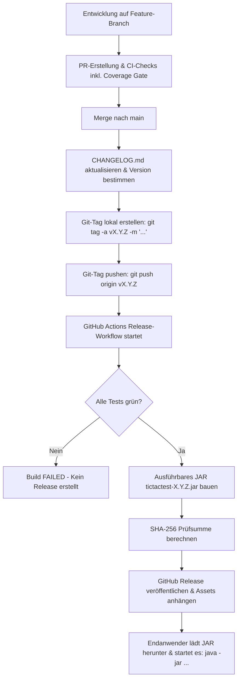

# Release-Dokumentation für TicTacTest

Dieses Dokument beschreibt den kontrollierten, reproduzierbaren Release-Prozess für die TicTacTest-Anwendung gemäss den Anforderungen von Modul 324 (DevOps).

---

## 1. Übersicht & Fragestellungen

### Wann wird ein Release erstellt?
Ein Release wird erstellt, wenn ein stabiler, getesteter Entwicklungsstand auf dem `main`-Branch vorliegt, der neue Features, Verbesserungen oder Bugfixes enthält, die für Endanwender oder andere Entwickler als lauffähige Software bereitgestellt werden sollen.

### Wer beziehungsweise was startet einen Release?
Ein Release wird **bewusst durch einen Entwickler** gestartet, indem ein annotierter Git-Tag (z. B. `v1.0.0` oder `v1.1.0`) erstellt und auf das Remote-Repository gepusht wird (oder manuell via `workflow_dispatch` in GitHub Actions ausgelöst wird).

### Warum löst nicht jeder Push auf main einen Release aus?
Nicht jeder Commit auf `main` stellt eine fertige, für Endnutzer gedachte Version dar. Oft fliessen mehrere Commits (z. B. Dokumentations-Updates, Dependency-Updates, Refactorings) ein, bevor ein Stand als offizieller Release freigegeben wird. Ein normaler Push auf `main` führt nur die CI-Pipeline (Build, Test, Coverage-Report) aus, publiziert aber kein Release-Artefakt.

### Wie wird die Versionsnummer festgelegt?
Wir verwenden **Semantic Versioning (SemVer)** im Format `MAJOR.MINOR.PATCH`:
- **MAJOR:** Inkompatible Änderungen (z. B. grundlegende Änderungen am Interface oder Spielablauf).
- **MINOR:** Neue, abwärtskompatible Features (z. B. Hinzufügen des `PerfectPlayer`, E2E-Tests).
- **PATCH:** Abwärtskompatible Bugfixes (z. B. Behebung des `Scanner`-Bugs in `HumanPlayer`).

### Wie wird ein Release-Tag erstellt?
Lokal über das Git-CLI:
```bash
# 1. Annotierten Tag mit Versionsnummer und Beschreibung erstellen
git tag -a v1.1.0 -m "Release v1.1.0: Perfect Player, Pioneer E2E-Tests und Bugfixes"

# 2. Tag zum Remote-Repository pushen (startet die GitHub Actions Release-Pipeline)
git push origin v1.1.0
```

### Welcher Commit gehört zu einem Release?
Der Release-Tag zeigt exakt auf den Git-Commit (Commit-SHA), auf dem der Tag gesetzt wurde. Bei `git push origin <tag>` baut die Pipeline genau diesen referenzierten Commit.

### Wie wird das JAR gebaut?
Das ausführbare JAR wird automatisiert über Gradle erzeugt:
```bash
./gradlew jar -PprojVersion=1.1.0 --no-daemon
```
Dabei konfiguriert das `jar`-Task in `build.gradle` das `META-INF/MANIFEST.MF` mit `Main-Class: ch.bbw.m450.tictactoe.TicTacToeMain`. Das Ergebnis ist ein lauffähiges JAR im Verzeichnis `build/libs/tictactest-1.1.0.jar`.

### Wo kann das JAR heruntergeladen werden?
Direkt auf der **GitHub Release-Seite** des Repositories unter `Releases` -> `Assets`:
- `tictactest-<version>.jar`
- `checksums.txt` (SHA-256 Prüfsumme)

### Was enthält das Changelog?
Die Datei `CHANGELOG.md` enthält nach Version und Datum gegliederte Abschnitte:
- `Added`: Neu hinzugefügte Funktionalitäten.
- `Changed`: Modifizierte bestehende Logik.
- `Fixed`: Behobene Fehler mit Verweis auf Issues/Tickets.

### Was passiert, wenn beim Release ein Test fehlschlägt?
Der GitHub-Actions-Workflow bricht im Schritt `Build and test` sofort ab (`set -e`). Es wird **kein** GitHub Release erstellt und **kein** fehlerhaftes JAR veröffentlicht. Der Entwickler erhält eine Benachrichtigung, muss den Fehler auf einem Feature-Branch beheben, mergen und den Tag ggf. nach Korrektur neu setzen.

---

## 2. Ablaufdiagramm des Release-Prozesses



---

## 3. Manuelle Überprüfung eines Releases

Nach der Veröffentlichung wird das Artefakt verifiziert:
```bash
# 1. JAR aus GitHub Releases herunterladen
curl -L -o tictactest-1.1.0.jar https://github.com/<owner>/<repo>/releases/download/v1.1.0/tictactest-1.1.0.jar

# 2. Prüfsumme validieren
sha256sum tictactest-1.1.0.jar

# 3. Anwendung direkt ohne Build-Tools ausführen
java -jar tictactest-1.1.0.jar
```
