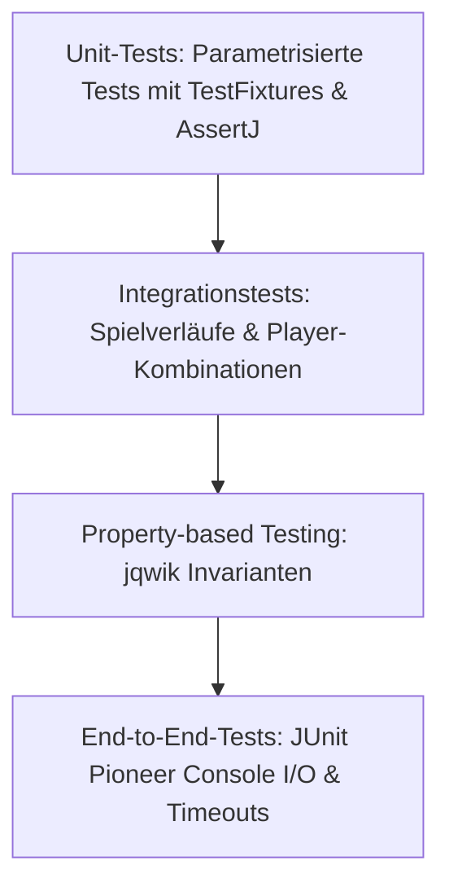

# Testkonzept Tic-Tac-Toe

**Modul 450 – Applikationen testen**  
**Projekt:** TicTacTest  
**Autor:** Berner / 5IA23c / 5IA23f  
**Status:** Vollständig aktualisiert (Stand: November 2026)

---

## 1. Ziel und Testziele

Das Testkonzept stellt die korrekte, robuste und sichere Funktion der Tic-Tac-Toe-Spiellogik sowie der Konsolen-Benutzerinteraktion sicher.

### Hauptziele:
1. **Regelkonformität & Spiellogik:** Korrekte Erkennung von Siegen (horizontal, vertikal, diagonal) und Unentschieden.
2. **Robustheit & Fehlertoleranz:** Saubere Behandlung ungültiger und böswilliger Eingaben ohne Abstürze (`NumberFormatException`, `NoSuchElementException`).
3. **Schutz vor Denial-of-Service (DoS):** Absicherung aller Test- und Spielabläufe durch strikte Timeouts (`@Timeout`), um Endlosschleifen zu verhindern.
4. **Unschlagbarer Computer-Gegner:** Verifikation des `PerfectPlayer` (Minimax), der nachweislich niemals verliert.
5. **Hohe Testabdeckung & Testqualität:** Einhaltung des **90-%-Branch-Coverage-Gates** in JaCoCo und Validierung der Teststärke durch **Mutation Testing (PITest)**.

---

## 2. Testumfang und Testobjekte

Im Testumfang befinden sich alle Kernkomponenten:
- `TicTacToeMain.isWin(Stone[] board, Stone color)`: Alle 8 Gewinnkombinationen sowie Nicht-Gewinnlagen.
- `TicTacToeMain.play(TicTacToePlayer xPlayer, TicTacToePlayer oPlayer)`: Gesamter Spielablauf, Zugvalidierung, Abbrüche, Unentschieden und Siegerückgabe.
- `TicTacToeMain.toString(Stone[] board)`: Formatierung der Konsolenansicht.
- `GreedyPlayer`: Naive Zugstrategie (erstes freies Feld von oben links).
- `PerfectPlayer`: Optimale Minimax-Zugstrategie.
- `HumanPlayer`: Interaktive Konsoleneingabe mit Input-Validierung und Dependency Injection.
- `TicTacToePlayer.Stone`: Enum-Logik (`opponent()`).

---

## 3. Teststufen und Testarchitektur (Testpyramide)



### Stufe 1: Unit-Tests (Basis)
- Isolierte Methodenprüfung mit JUnit 5 (`@Test`, `@ParameterizedTest`, `@MethodSource`).
- Testdaten werden strukturiert über `TicTacToeTestFixtures.board(...)` bereitgestellt.
- Aussagekräftige Assertions mit **AssertJ** (`assertThat(...)`).

### Stufe 2: Integrationstests
- Zusammenspiel zweier unterschiedlicher Spieler-Typen in `TicTacToeMain.play()`.
- Simulation kompletter Runden (Gewinn X, Gewinn O, Remis).

### Stufe 3: Property-based Testing (jqwik)
- Zufallsbasierte Generierung hunderter Spielfelder und Zustände.
- Überprüfung von Invarianten:
  - Jeder Zug eines Spielers landet auf einem gültigen, zuvor freien Feld (`0..8`).
  - Ein Sieg erfordert zwingend mindestens 3 Steine der jeweiligen Farbe.
  - Das Invertieren des Gegners ist selbst-invertierend (`s.opponent().opponent() == s`).

### Stufe 4: End-to-End-Tests (JUnit Pioneer)
- Vollständiger Konsolen-Durchlauf mit simuliertem Benutzerinput über `@StdIo`, `@StdIn` und `@StdOut`.
- Prüfung echter `main()`-Aufrufe und Terminal-Ausgaben.

---

## 4. Testfälle

### 4.1 Unit- & Integrationstests (`TicTacToeMainTest`, `PerfectPlayerTest`)

| ID | Bereich | Testfall-Beschreibung | Erwartetes Ergebnis | Status |
|---|---|---|---|---|
| TC-01 | Gewinnerkennung | Horizontale Reihen (Reihe 0, 1, 2) mit `Stone.CROSS` / `CIRCLE` | `isWin() == true` | Bestanden |
| TC-02 | Gewinnerkennung | Vertikale Spalten (Spalte 0, 1, 2) mit `Stone.CROSS` / `CIRCLE` | `isWin() == true` | Bestanden |
| TC-03 | Gewinnerkennung | Diagonale 1 (0, 4, 8) und Diagonale 2 (2, 4, 6) | `isWin() == true` | Bestanden |
| TC-04 | Gewinnerkennung | Leeres Spielfeld | `isWin() == false` | Bestanden |
| TC-05 | Gewinnerkennung | Voll belegtes Spielfeld ohne 3 in einer Reihe | `isWin() == false` | Bestanden |
| TC-06 | Gewinnerkennung | Gegner hat 3 in einer Reihe, abgefragt für eigene Farbe | `isWin() == false` | Bestanden |
| TC-07 | Spielablauf | Identische Spieler-Objekte übergeben | `IllegalArgumentException` | Bestanden |
| TC-08 | Spielablauf | Spieler liefert ungültigen negativen Index (`-1`) | `IllegalStateException` | Bestanden |
| TC-09 | Spielablauf | Spieler liefert ungültigen Index (`>= 9`) | `IllegalStateException` | Bestanden |
| TC-10 | Spielablauf | Spieler liefert bereits belegtes Feld | `IllegalStateException` | Bestanden |
| TC-11 | Spielablauf | Spieler X gewinnt horizontal | Sieger `Stone.CROSS` zurückgegeben | Bestanden |
| TC-12 | Spielablauf | Spieler O gewinnt vertikal | Sieger `Stone.CIRCLE` zurückgegeben | Bestanden |
| TC-13 | Spielablauf | Alle 9 Züge gespielt ohne 3er-Reihe | `null` (Unentschieden) zurückgegeben | Bestanden |
| TC-14 | GreedyPlayer | Freies Feld auf Position 1 wählen | Position 1 gewählt | Bestanden |
| TC-15 | GreedyPlayer | Aufruf auf voll belegtem Board | `IllegalStateException` | Bestanden |
| TC-16 | PerfectPlayer | Sofortiger Siegzug bei offener 2er-Reihe | Gewinnfeld wird gewählt | Bestanden |
| TC-17 | PerfectPlayer | Gegner-Sieg blockieren bei Bedrohung | Blockierfeld wird gewählt | Bestanden |
| TC-18 | PerfectPlayer | Spiel gegen `GreedyPlayer` als Startspieler | Sieg für `PerfectPlayer` (`CROSS`) | Bestanden |
| TC-19 | PerfectPlayer | Spiel gegen `GreedyPlayer` als Zweitspieler | Sieg oder Unentschieden (keine Niederlage) | Bestanden |
| TC-20 | PerfectPlayer | Spiel gegen zweiten `PerfectPlayer` | Garantiertes Unentschieden (`null`) | Bestanden |

---

### 4.2 End-to-End-Konsolentests mit JUnit Pioneer (`TicTacToeConsoleE2ETest`)

| ID | Szenario | Eingaben (`StdIn`) | Erwartetes Verhalten | Tatsächliches Verhalten |
|---|---|---|---|---|
| E2E-01 | Vollständiger Spielablauf: Mensch gewinnt | `"0\n3\n6\n"` | Human (X) setzt 0, 3, 6; Greedy (O) setzt 1, 2. X gewinnt vertikal. | Siegmeldung `...and the winner is: CROSS` erscheint im Konsolen-Output. |
| E2E-02 | Vollständiger Spielablauf: Computer gewinnt | `"4\n5\n"` | Greedy (X) setzt 0, 1, 2. Human (O) setzt 4, 5. Greedy gewinnt horizontal. | Siegmeldung `...and the winner is: CROSS` erscheint. |
| E2E-03 | Ungültige Eingaben & Böswilliger User-Input | `"invalid_text\n-5\n99\n4\n"` | System fängt Fehleingaben ab, gibt Fehlermeldungen aus und akzeptiert schliesslich die gültige `4`. | Fehlermeldungen werden ausgegeben; kein Crash; Zug 4 wird ausgeführt. |
| E2E-04 | Belegtes Feld ausgewählt | `"0\n4\n"` (Feld 0 besetzt) | Meldung `Position 0 is already occupied`, erneute Aufforderung. | Feld 4 wird erfolgreich gewählt. |
| E2E-05 | Full Entry-Point & DoS-Schutz | `"0\n3\n6\n"` | `TicTacToeMain.main()` startet, spielt ein Match durch und beendet innerhalb von 5 Sekunden. | Erfolgreich ausgeführt unter `@Timeout(5s)`. |

---

## 5. Dokumentation von Fehlern & Test-First-Behebung

### 5.1 Gefundener Fehler 1: `Scanner`-Closure-Bug in `HumanPlayer`
- **Symptom:** In der ursprünglichen Version wurde im `HumanPlayer.play()` ein `try (var scanner = new Scanner(System.in))` verwendet.
- **Fehlerursache:** Beim Verlassen des ersten Zuges schloss der `try-with-resources`-Block den `Scanner` und damit unweigerlich den darunterliegenden Stream `System.in`. In Runde 2 war `System.in` geschlossen, was zu einer `NoSuchElementException` führte.
- **Test-First-Behebung:**
  1. Testfall geschrieben, der zwei Züge hintereinander aufruft.
  2. Implementierung refaktoriert: `Scanner` wird als Instanzvariable gehalten und `System.in` nicht mehr geschlossen.
  3. Dependency Injection ergänzt: Konstruktor `HumanPlayer(InputStream in)` hinzugefügt, sodass Konsolentests ohne globale Manipulationen möglich sind.

### 5.2 Gefundener Fehler 2: Absturz bei nicht-numerischen Eingaben
- **Symptom:** Eingaben wie `"abc"` führten zu einem unkontrollierten Absturz mit `NumberFormatException`.
- **Behebung:** `try-catch`-Block um `Integer.parseInt()` innerhalb einer `while(true)`-Schleife mit benutzerfreundlicher Wiederholungsaufforderung.

---

## 6. Testabdeckung (Coverage) & Quality Gates

### 6.1 JaCoCo Code Coverage
Die Abdeckung wird bei jedem Build via JaCoCo ermittelt (`build.gradle` -> `jacocoTestReport`):
- **Instruction Coverage:** **99.5 %** (603 von 606 Instructions abgedeckt)
- **Branch Coverage:** **100.0 %** (118 von 118 Branches abgedeckt)
- **Line Coverage:** **99.0 %**

### 6.2 CI Quality Gate (`.github/scripts/coverage_gate.py`)
In GitHub Actions prüft das Gate bei jedem Pull Request:
1. Ist die **Branch Coverage >= 90.0 %**? (Kriterium aus Modul 450)
2. Ist die Testabdeckung im Vergleich zum `main`-Branch gleich geblieben oder gestiegen?
Fällt die Abdeckung unter 90 %, schlägt der PR-Status-Check fehl (`exit 1`).

---

## 7. Mutation Testing mit PITest

Mutation Testing prüft, ob die Tests inhaltlich Fehler erkennen, indem gezielt Operatoren mutiert werden (z. B. `<` zu `<=`, `true` zu `false`, mathematische Operatoren).

### Ausführung:
```bash
./gradlew pitest --no-daemon
```

### Ergebnisse (PITest Gregor Mutator Suite):
- **Mutations Generated:** 98 Mutanten
- **Mutations Killed:** 87 Mutanten
- **Mutation Coverage (Test Strength):** **89 %**
- **Line Coverage auf mutierten Klassen:** **100 %**
- **Ausgeführte Tests pro Mutation:** 2.54 Tests/Mutation

---

## 8. Fazit und Abnahmekriterien

Alle geforderten Kriterien für Modul 450 und 324 sind erfüllt:
- [x] Unit-Tests & Integrationstests vollständig vorhanden
- [x] Unschlagbarer `PerfectPlayer` (Minimax) implementiert und getestet
- [x] JUnit Pioneer E2E-Konsolentests mit DoS-Timeouts implementiert
- [x] Property-based Testing mit `jqwik` umgesetzt
- [x] Mutation Testing mit PITest erfolgreich integriert
- [x] 90 % Branch-Coverage-Gate im CI-Script aktiv (aktuell 100 % Branch Coverage)
- [x] Release-Prozess mit `CHANGELOG.md`, `RELEASE.md` und GitHub Action `.github/workflows/release.yml`
